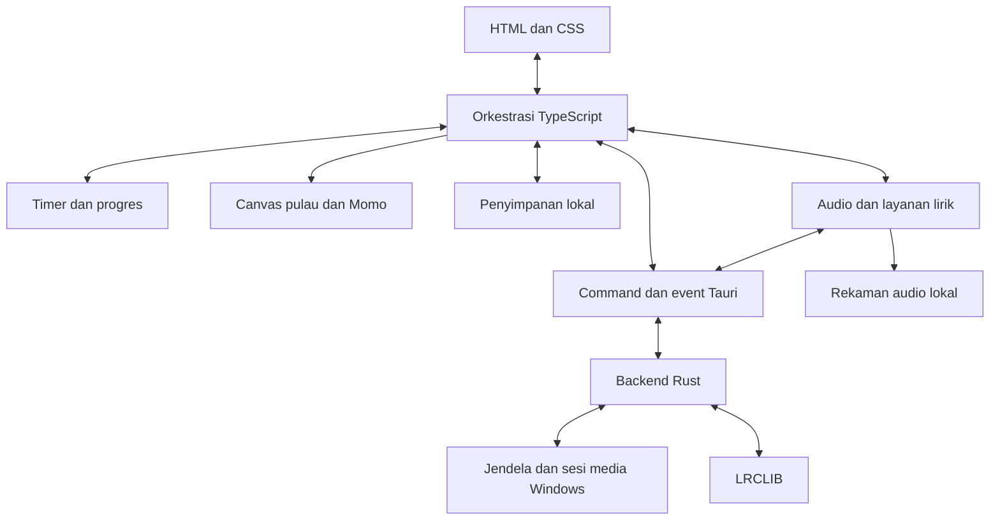

# Moss Island

Moss Island adalah aplikasi pendamping desktop untuk membantu menjaga ritme fokus, istirahat, dan minum air. Aplikasi tampil sebagai pulau kecil yang selalu terlihat di atas jendela lain, dengan Momo sebagai karakter pendamping. Sesi fokus, perkembangan pulau, musik, dan pengingat disatukan dalam antarmuka yang dapat dibuka penuh, diperkecil menjadi bilah, atau ditampilkan sebagai pet.

Proyek memakai **Tauri 2, Rust, TypeScript, HTML/CSS, dan Canvas 2D**. Integrasi media serta audio sistem saat ini berfokus pada **Windows**; dukungan desktop lain belum diverifikasi.

## Tujuan proyek

- Membantu pengguna membangun kebiasaan fokus melalui sesi Pomodoro dan jeda yang teratur.
- Memberi umpan balik visual lewat pertumbuhan pohon, perubahan musim, dan aktivitas Momo.
- Menyediakan kontrol musik dan pengingat minum saat istirahat tanpa perlu meninggalkan pekerjaan terlalu lama.
- Menjaga akses ke pendamping desktop dalam ukuran kecil, dengan pilihan posisi mengambang atau menempel di tepi layar.

## Fitur utama

| Area | Perilaku |
| --- | --- |
| Fokus dan pulau | Durasi pilihan mencakup fokus dan istirahat. Contoh: 3 jam dibagi menjadi 2 jam 25 menit fokus dan 35 menit istirahat. Lingkaran waktu berada di samping kebun. Progres sesi menumbuhkan pohon, dengan musim dan aktivitas berkebun Momo. |
| Istirahat | Tab Focus berganti menjadi Istirahat dengan lingkaran hitung mundur, pengingat minum, dan ajakan merilekskan tubuh. |
| Musik | Playlist audio lokal serta metadata, artwork, timeline, dan kontrol sesi media Windows sesuai kemampuan pemutar. |
| Lirik | Pencarian melalui LRCLIB, lirik bertimestamp bila tersedia, dan koreksi waktu per rekaman. |
| Mode desktop | Panel penuh, bilah minimize, dan pet utuh yang berjalan menghadap kiri/kanan serta perlahan menjauhi kursor. Saat musik diputar, Momo sesekali menari, melambai, atau bereaksi lucu. |
| Posisi jendela | Dapat mengambang; snap ke tepi baru berlaku dalam ambang 10% area kerja layar. |
| Akses cepat | Tray, shortcut `Ctrl+Shift+M` di Windows, pengaturan selalu di atas, dan dukungan autostart. |

Bilah minimize dan mode pet adalah dua tampilan berbeda. Acuan visual Momo mengikuti aset Figma lokal; pose berjalan samping merupakan adaptasi untuk pet desktop.

Cuaca pulau mengikuti musim: gerimis sesekali pada musim semi, hujan lebih jarang dan singkat saat panas, hujan lebih lama saat gugur, serta salju tanpa hujan atau genangan saat dingin. Genangan mengering bertahap; Momo menunda berkebun saat hujan dan melanjutkannya setelah reda. Cuaca ini simulasi visual, bukan laporan cuaca lokasi pengguna.

Tunas baru langsung mendapat antrean tanam, siram, dan pupuk, kemudian dijadwalkan disiram setiap 30 detik aktif. Pohon dewasa mendapat satu kunjungan per 60 detik aktif dengan urutan acak tanpa pengulangan sampai seluruh pohon dikunjungi. Waktu perjalanan dan pekerjaan yang sedang berlangsung dapat menunda kedatangan; jeda, istirahat, dan hujan menahan jadwal tanpa menumpuk pekerjaan. Animasi berkebun dan gerak mendapat prioritas di atas aksi dekoratif.

Kelima spesies pohon tropis mempertahankan daun pada musim gugur, dengan detail bunga, buah, ujung daun, dan aksen dingin yang berbeda sesuai musim dalam simulasi pulau.

## Arsitektur

Frontend berjalan di WebView Tauri. TypeScript mengatur interaksi, state aplikasi, timer, dan animasi; Rust menangani kemampuan native Windows. Keduanya bertukar data melalui command dan event Tauri.



| Lapisan | Berkas utama | Tanggung jawab |
| --- | --- | --- |
| Antarmuka dan orkestrasi | `index.html`, `src/styles.css`, `src/main.ts` | Panel, interaksi, pergantian mode, dan koordinasi fitur. |
| Fokus dan data | `src/timer/`, `src/storage.ts`, `src/settings.ts`, `src/types.ts` | Rencana Pomodoro, siklus timer, validasi, progres, dan penyimpanan state lokal. |
| Dunia visual | `src/canvas/`, `src/assets/` | Render pulau, pohon, musim, cuaca visual, dan animasi karakter. |
| Perilaku desktop | `src/desktopPet.ts`, `src/edgeDock.ts`, `src/hoverIntent.ts` | Gerak pet, ambang snap, dan perilaku hover. |
| Musik dan lirik | `src/audio/` | Pemutaran lokal, sinkronisasi sesi media, artwork, clock, pencocokan dan tampilan lirik. |
| Integrasi native | `src-tauri/src/lib.rs`, `media.rs`, `lyrics.rs`, `speaker_beat.rs`, `volume.rs` | Geometri jendela, tray/shortcut, media Windows, transport lirik, analisis ketukan audio sistem, dan volume. |
| Verifikasi | `tests/test_suite.ts`, tes Rust, `.github/workflows/ci.yml` | Tes logika, pemeriksaan tipe/build, ESLint, dan Clippy. |

Pada jalur musik Windows, frontend membaca sesi melalui backend Rust. Metadata, artwork, dan kontrol dijaga agar merujuk sesi yang sama; hasil permintaan lama tidak boleh menimpa rekaman yang baru aktif. Lirik berasal dari LRCLIB, bukan katalog lirik Spotify. Pada desktop, permintaan lirik melewati Rust; mode browser menggunakan transport web.

State aplikasi disimpan secara lokal melalui `src/storage.ts`. Integrasi sesi media Windows, tray, shortcut global, dan pergerakan jendela membutuhkan runtime Tauri; preview browser hanya mencakup bagian web. Pengambilan lirik dan artwork dari layanan luar membutuhkan jaringan.

## Menjalankan proyek

Untuk pengembangan desktop Windows, siapkan Node.js **22**, Rust beserta toolchain MSVC, Microsoft C++ Build Tools, dan WebView2. CI menggunakan Rust **1.99.1**.

```powershell
npm ci
npm run tauri dev
```

Untuk menjalankan frontend di browser:

```powershell
npm run dev
```

Untuk membuat paket desktop:

```powershell
npm run tauri build
```

Rekaman playlist tidak disertakan dalam repositori. Aplikasi tetap dapat dibangun tanpa rekaman; lihat bagian **Audio lokal** untuk menyiapkan pemutarannya.

## Pemeriksaan kualitas

Workflow [CI](.github/workflows/ci.yml) berjalan pada push ke `main`, pull request, atau pemicu manual di Windows.

| Pemeriksaan | Yang dijawab | Perintah lokal dari root |
| --- | --- | --- |
| Tipe/build | Apakah kode valid dan bisa dibangun? | `npm run build`, `cargo check --locked --all-targets --manifest-path src-tauri/Cargo.toml` |
| Tes logika | Apakah perilaku yang diuji sesuai harapan? | `npm test`, `cargo test --locked --manifest-path src-tauri/Cargo.toml` |
| ESLint/Clippy | Adakah pola kode mencurigakan meskipun bisa dibangun? | `npm run lint`, `cargo clippy --locked --all-targets --manifest-path src-tauri/Cargo.toml -- -D warnings` |

Jalankan `npm ci` untuk memasang dependensi frontend. CI memasang Rust **1.99.1** beserta komponen Clippy; gunakan versi compiler yang sama untuk hasil lint Rust yang konsisten. `rustc --version` dan `cargo clippy --version` menampilkan versi lokal.

ESLint memakai aturan recommended JavaScript/TypeScript serta pemeriksaan bertipe untuk `await` non-Promise dan penyalahgunaan Promise. Pemeriksaan mencakup `src`, `tests`, konfigurasi Vite, serta berkas `.mjs` di root. `--max-warnings 0` membuat peringatan menggagalkan CI. Berkas hasil build dan Rust diabaikan oleh ESLint karena memiliki pemeriksa tersendiri.

Pengecualian terbatas: mock tes lama boleh memakai `any`; callback DOM/Tauri boleh async; parameter/nama error berawalan `_` yang sengaja diabaikan dan properti yang dikeluarkan melalui rest destructuring tidak dianggap tidak terpakai. Satu alias `this` untuk mengamati instance Audio pada mock tes diberi alasan di barisnya. Kode aplikasi tetap diperiksa terhadap `any` eksplisit.

Clippy memeriksa seluruh target dan memperlakukan peringatan sebagai error. Command Tauri `animate_island_window` memiliki pengecualian lokal untuk jumlah argumen agar kontrak IPC frontend tidak berubah; pemeriksaan Clippy lain tetap berlaku.

Dependensi lint memakai override terbatas `minimatch@^10.0.0` ke `11.0.4` untuk menghindari [GHSA-g3hv-75wg-m249](https://github.com/advisories/GHSA-g3hv-75wg-m249). Tinjau kembali override setelah dependensi induk mengadopsi versi yang diperbaiki. Jangan menjalankan `npm audit fix --force` karena rekomendasinya dapat menurunkan ESLint ke versi mayor lama.

Tes perangkat/jaringan Rust yang ditandai ignored tetap tidak dijalankan otomatis. Lint dan tes logika tidak menggantikan pemeriksaan UI atau integrasi pemutar media pada desktop nyata.

## Audio lokal

Rekaman audio besar tidak disertakan dalam Git. Folder `public/audio` menyimpan kredit dan ilustrasi SVG, sementara rekaman `.webm`, `.mp3`, `.ogg`, `.wav`, `.flac`, dan `.m4a` diabaikan Git. Berkas yang sudah ada di laptop tetap dipertahankan.

Untuk memakai playlist bawaan, sediakan rekaman yang penggunaannya diizinkan pada lokasi berikut:

| Trek | Berkas lokal |
| --- | --- |
| Jazz Noir | `public/audio/zmeHQsFYOYg.webm` |
| Wave to Earth | `public/audio/QOC5v9Yaj_k.webm` |
| Laufey | `public/audio/PggT2sFOsVg.webm` |
| Rainy Lo-fi | `public/audio/9kzE8isXlQY.webm` |

Lihat [kredit dan batas distribusi](public/audio/CREDITS.md). Clone baru tetap dapat menjalankan lint, tes logika, dan build tanpa rekaman tersebut; pemutaran playlist bawaan memerlukan berkas lokalnya. Sesi media Windows memakai sumber dari pemutar yang sedang berjalan.

`npm run test:audio` memeriksa keberadaan, ukuran, header WebM dan kredit keempat rekaman. Perintah ini sengaja terpisah dari CI karena berkasnya hanya ada secara lokal. Pemeriksaan katalog/kredit/ilustrasi serta perilaku pemutaran melalui mock tetap berada dalam `npm test`.
